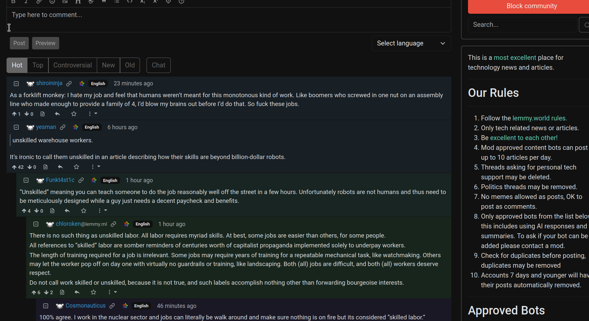

# Super Lemmy

**A classic Reddit-inspired interface for Lemmy.**

Super Lemmy is a collection of custom CSS and JavaScript enhancements designed to make the standard Lemmy web interface feel more like old Reddit, with some functionality inspired by Reddit Enhancement Suite (RES).

The goal is a compact, information-dense interface with improved comment navigation, image handling, and browsing.

Super Lemmy is available as a standalone Firefox extension, with the original Stylus and Tampermonkey installation methods also supported.

The project is currently in early development. Feedback, bug reports, and suggestions are welcome.

## AI Assistance

Super Lemmy was developed with assistance from OpenAI's ChatGPT, including JavaScript and CSS generation, debugging, and documentation.

The project's design, feature ideas, customization decisions, and testing have been directed by me. AI-generated code has been reviewed and iteratively refined through hands-on testing.

This is a personal, experimental project, and contributions, code reviews, and bug reports are welcome.

## Features

### Classic Reddit-style layout

- Compact posts with reduced whitespace
- Old Reddit-inspired post titles, metadata, and action links
- Redesigned voting controls and score placement
- Expanded use of horizontal screen space
- Adjusted sidebar positioning
- Less visual clutter

### Improved comments

- Color-coded comment nesting by depth
- Vertical indentation guides for following discussions
- Clickable collapse controls along comment threads
- Click-to-collapse comment headers
- Upvote and downvote totals displayed alongside voting controls
- Compact comment headers and spacing

### Images and media

- Expand post thumbnails directly in the feed
- Drag horizontally to resize expanded images
- Resize images embedded in posts and comments
- Different initial image-size limits for expanded thumbnails and embedded images
- Allow enlarged images to extend beyond their normal content columns
- Improved handling of original-resolution images in infinitely loaded posts
- Direct playback of supported video files in expanded posts

### Browsing enhancements

- Infinite scrolling on post listings
- Automatic loading of additional posts as you scroll
- Open post, community, and user links in new tabs
- Expand Markdown post bodies and link previews in dynamically loaded posts
- Voting support for dynamically loaded posts
- Support for dynamically loaded content and client-side navigation

## Screenshots

### Front Page


### Comment Threads



## Installation

There are two ways to install Super Lemmy:

1. **Standalone Firefox extension (recommended)** — Install one signed extension containing all CSS and JavaScript functionality.
2. **Stylus + Tampermonkey (manual installation)** — Install and maintain the original stylesheets and userscripts individually.

Use only one installation method at a time to avoid duplicate event handlers and conflicting styles.

### Option 1: Firefox extension (recommended)

1. Visit the [Super Lemmy GitHub Releases page](https://github.com/tangosox/Super-Lemmy/releases).
2. Open the latest release and click the signed `.xpi` file.
3. If Firefox displays an installation prompt, approve it.
4. If the file downloads instead, open it in Firefox or drag it onto the `about:addons` page, then approve installation.

The extension automatically loads all required CSS and JavaScript. **Stylus and Tampermonkey are not required.**

#### Extension updates

The Firefox extension includes a self-hosted update URL:

`https://tangosox.github.io/Super-Lemmy/updates.json`

Firefox uses this URL to check for newer signed releases.

Automatic update detection is configured. However, automated building, Mozilla signing, and GitHub release publishing are still being developed. Until that workflow is complete, new signed releases are published manually.

The extension does not automatically update when individual source-code commits are pushed to GitHub.

### Option 2: Stylus and Tampermonkey

The original installation method remains available for users who prefer separate stylesheets and userscripts.

Required Firefox extensions:

- **[Stylus](https://addons.mozilla.org/firefox/addon/styl-us/)** — Applies the custom CSS.
- **[Tampermonkey](https://www.tampermonkey.net/)** — Runs the JavaScript enhancements.

#### 1. Install the CSS

1. Install Stylus.
2. Create a new style for each CSS file.
3. Copy the contents of [`src/frontpage.css`](src/frontpage.css) and [`src/comments.css`](src/comments.css) into their respective styles.
4. In each style's **Applies to** section, select **URLs matching the regexp**.
5. Enter the following expression:

   ```regex
   ^https?://(lemmy\.[^/]+|feddit\.org)(/.*)?$
   ```

6. Save and enable both styles.

**Both styles should be enabled on all matching pages**, including individual posts and comment threads, because some shared interface rules are currently located in `frontpage.css`.

This expression supports Lemmy instances with domains beginning with `lemmy.`, such as `lemmy.world` and `lemmy.ca`, as well as `feddit.org`.

To add another instance with a different domain name, extend the expression with another alternative separated by `|`.

#### 2. Install the JavaScript

1. Install Tampermonkey.
2. Create a new userscript.
3. Copy the complete contents of [`src/comments.user.js`](src/comments.user.js), including its metadata header.
4. Save and enable the script.
5. Repeat with [`src/infinite-scroll.user.js`](src/infinite-scroll.user.js).

Both scripts should contain this directive in their metadata headers:

```javascript
// @include      /^https:\/\/(lemmy\.[^/]+|feddit\.org)(\/|$)/
```

This uses a regular expression in Tampermonkey's `@include` directive to support the same Lemmy instances as the Stylus styles.

The patterns differ slightly because Stylus accepts the regular expression directly, while Tampermonkey requires JavaScript regex delimiters and escaped forward slashes.

Keep the other existing metadata directives intact, including any external library dependencies.

#### 3. Reload Lemmy

Refresh your Lemmy page after saving the styles and scripts.

Verify that:

- Both Stylus styles are active.
- Both Tampermonkey scripts are enabled.
- The compact layout and comment formatting appear correctly.
- Infinite scrolling and other interactive features work as expected.

For best results, use all four files together.

#### Manual installation updates

After downloading updated source files, copy the revised CSS into Stylus and JavaScript into Tampermonkey.

Updating the Git repository does not automatically update installed Stylus styles or Tampermonkey userscripts.

## Repository structure

```text
Super-Lemmy/
├── images/
│   ├── comments.png
│   └── frontpage.png
├── src/
│   ├── comments.css
│   ├── comments.user.js
│   ├── frontpage.css
│   └── infinite-scroll.user.js
├── vendor/
│   └── markdown-it.min.js
├── .gitignore
├── LICENSE
├── manifest.json
├── README.md
└── updates.json
```

The `web-ext-artifacts/` directory is generated locally when building the extension and is excluded from Git.

### Source files

| File | Purpose |
|---|---|
| [`src/frontpage.css`](src/frontpage.css) | Front-page layout, post styling, and shared interface adjustments |
| [`src/comments.css`](src/comments.css) | Post and comment-page styling, indentation, and thread colors |
| [`src/comments.user.js`](src/comments.user.js) | Comment controls, metadata adjustments, and image resizing |
| [`src/infinite-scroll.user.js`](src/infinite-scroll.user.js) | Infinite scrolling, imported post interaction, voting, and expanded content |
| [`manifest.json`](manifest.json) | Firefox extension configuration, permissions, and content script loading |
| [`vendor/markdown-it.min.js`](vendor/markdown-it.min.js) | Bundled Markdown rendering dependency |
| [`updates.json`](updates.json) | Self-hosted Firefox extension update manifest |

### Cloning the repository

To download the complete project using Git:

```bash
git clone https://github.com/tangosox/Super-Lemmy.git
cd Super-Lemmy
```

Alternatively, use GitHub's **Code → Download ZIP** option.

### Development

The Firefox extension can be loaded directly from the repository without building or signing it.

1. Open Firefox and navigate to `about:debugging#/runtime/this-firefox`.
2. Click **Load Temporary Add-on**.
3. Select `manifest.json` from the repository.
4. Visit a supported Lemmy instance.

After modifying the source files, reload the temporary extension and refresh the page.

Disable the permanently installed Super Lemmy extension while testing a temporary development copy to avoid conflicts.

For command-line development, Mozilla's `web-ext` utility can also be used:

```bash
web-ext run --source-dir .
```

### Building

Install Mozilla's `web-ext` utility using npm:

```bash
npm install -g web-ext
```

Validate the extension:

```bash
web-ext lint
```

Build the extension:

```bash
web-ext build
```

The resulting ZIP archive is saved to `web-ext-artifacts/`.

Regular Firefox installations require Mozilla-signed extensions for permanent installation. Unlisted signing is available through the Mozilla Add-ons Developer Hub.

## Compatibility

Super Lemmy is currently developed and tested primarily with:

- Firefox on Linux
- The standard Lemmy web interface (`lemmy-ui`)
- `lemmy.world`

The Firefox extension currently matches:

- `lemmy.world`
- `lemmy.ca`
- `lemmy.ml`
- `feddit.org`

The manual Stylus and Tampermonkey installation supports additional instances through configurable URL-matching expressions.

Compatibility across these instances has not been comprehensively tested. Different Lemmy versions may produce different results.

Alternative frontends such as Photon, Alexandrite, and Tesseract are not currently supported.

## Known limitations

Super Lemmy is experimental, and some functionality remains a work in progress.

- Infinite scrolling does not currently preserve loaded posts when navigating back to the feed.
- Community-specific infinite scrolling and some other listing types may require additional testing.
- Lemmy frontend updates may break selectors or custom behavior.
- Some layouts and media types may behave differently across instances.
- Direct video expansion supports common video file URLs but does not provide universal video embedding.
- Browser and frontend compatibility testing is limited.
- The Firefox extension does not yet provide configurable options.
- Automatic signing and release publishing through GitHub Actions are not yet configured.
- The manual Stylus/Tampermonkey installation requires separate updates.

## Roadmap

Potential future improvements include:

- [x] Package Super Lemmy as a standalone Firefox extension
- [x] Bundle Markdown rendering dependencies locally
- [x] Obtain Mozilla signing for permanent Firefox installation
- [x] Configure a self-hosted Firefox update URL
- [ ] Automate extension signing and publishing through GitHub Actions
- [ ] Audit and refactor existing JavaScript and CSS while preserving working behavior
- [ ] Add a graphical settings interface for individual features
- [ ] Make image-size limits and other interface preferences configurable
- [ ] Improve infinite-scroll navigation and history restoration
- [ ] Improve compatibility across Lemmy instances
- [ ] Refine responsive layouts
- [ ] Reduce duplicated code and improve performance

## Feedback and contributions

Super Lemmy is being shared early to gather feedback from the Lemmy community.

If you encounter a bug or have a feature suggestion, please [open a GitHub Issue](https://github.com/tangosox/Super-Lemmy/issues).

When reporting a problem, it helps to include:

- Your Lemmy instance and its URL
- Your browser and version
- A description of the problem
- Steps to reproduce the issue
- A screenshot or example URL, if applicable

Pull requests, suggestions, and code reviews are welcome.

Please keep contributions compatible with the project's existing functionality unless a behavioral change is explicitly intended.

## Project status

**Early development / experimental — Firefox extension v0.1.0**

Super Lemmy is now available as a standalone, Mozilla-signed Firefox extension.

The original Stylus and Tampermonkey scripts remain available for manual installation.

The immediate priorities are improving the existing functionality, configuring automated releases, and preparing a future extension version with customizable settings.

## License

Super Lemmy is released under the [MIT License](LICENSE).

Copyright © 2026 tangosox.

You are free to use, modify, and redistribute the project under the terms of the MIT License.
