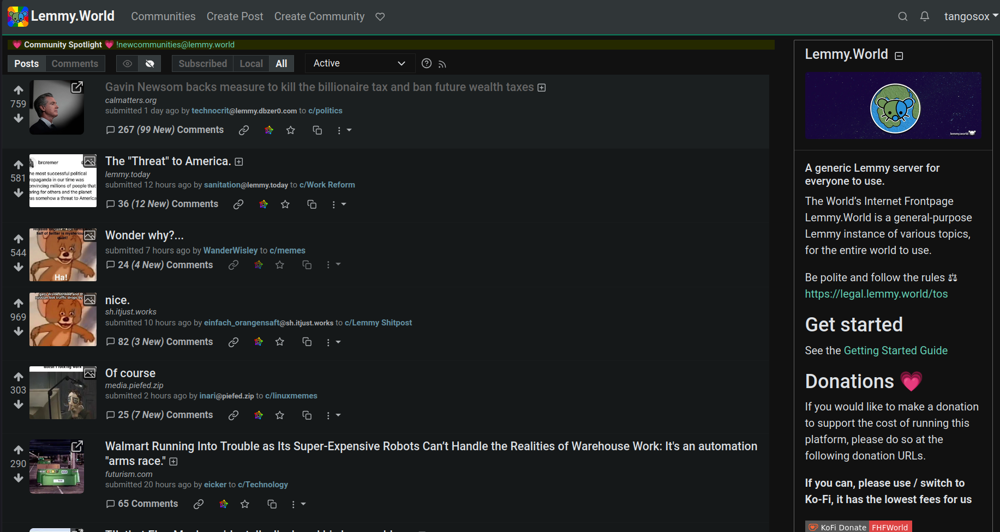

# Super Lemmy

**A classic Reddit-inspired interface for Lemmy.**

Super Lemmy is a collection of custom CSS and JavaScript enhancements designed to make the standard Lemmy web interface feel more like old Reddit, with some functionality inspired by Reddit Enhancement Suite (RES).

The goal is a compact, information-dense interface with improved comment navigation, image handling, and browsing.

The project is currently in early development. Feedback, bug reports, and suggestions are welcome.

## AI Assistance

Super Lemmy was developed with assistance from OpenAI's ChatGPT, including JavaScript and CSS generation, debugging, and documentation.

The project's design, feature ideas, customization decisions, and testing have been directed by me. AI-generated code has been reviewed and iteratively refined through hands-on testing.

This is a personal, experimental project, and contributions, code reviews, and bug reports are welcome.

## Features

### Classic Reddit-style layout
- Compact posts with reduced whitespace
- Old Reddit-inspired post titles, metadata, and action links
- Redesigned voting controls and score placement
- Expanded use of horizontal screen space
- Adjusted sidebar positioning
- Less visual clutter

### Improved comments
- Color-coded comment nesting by depth
- Vertical indentation guides for following discussions
- Clickable collapse controls along comment threads
- Click-to-collapse comment headers
- Upvote and downvote totals displayed alongside voting controls
- Compact comment headers and spacing

### Images and media
- Expand post thumbnails directly in the feed
- Drag horizontally to resize expanded images
- Resize images embedded in posts and comments
- Different initial image-size limits for expanded thumbnails and embedded images
- Allow enlarged images to extend beyond their normal content columns
- Improved handling of original-resolution images in infinitely loaded posts

### Browsing enhancements
- Infinite scrolling on post listings
- Automatic loading of additional posts as you scroll
- Open links in new tabs on post pages
- Support for dynamically loaded content

## Screenshots

### Front Page



### Comment Threads


## Installation

Super Lemmy currently uses two Firefox extensions:

- **[Stylus](https://add0n.com/stylus.html)** — Applies the custom CSS.
- **[Tampermonkey](https://www.tampermonkey.net/)** — Runs the JavaScript enhancements.

Super Lemmy itself is not yet a standalone browser extension.

### Files

| File | Purpose |
|---|---|
| `frontpage.css` | Front-page layout and appearance |
| `comments.css` | Post and comment-page styling |
| `comments.user.js` | Comment controls, metadata, and image resizing |
| `infinite-scroll.user.js` | Infinite scrolling and expanded image handling |

### 1. Install the CSS

1. Install Stylus.
2. Create a new style for each CSS file.
3. Copy the contents of `frontpage.css` and `comments.css` into their respective styles.
4. In each style's **Applies to** section, select **URLs matching the regexp**.
5. Enter the following expression:

   ```regex
   ^https?://(lemmy\.[^/]+|feddit\.org)(/|$)
   ```

6. Save and enable both styles.

This single expression supports Lemmy instances with domains beginning with `lemmy.`, such as `lemmy.world` and `lemmy.ca`, as well as `feddit.org`.

To add another instance with a different domain name, extend the expression with another alternative separated by `|`.

### 2. Install the JavaScript

1. Install Tampermonkey.
2. Create a new userscript.
3. Copy the complete contents of `comments.user.js`, including its metadata header.
4. Save and enable the script.
5. Repeat with `infinite-scroll.user.js`.

Both scripts should contain this directive in their existing metadata headers:

```javascript
// @include      /^https:\/\/(lemmy\.[^/]+|feddit\.org)(\/|$)/
```

This uses a regular expression in Tampermonkey's `@include` directive to support the same Lemmy instances as the Stylus styles.

The patterns differ slightly because Stylus accepts the regular expression directly, while Tampermonkey requires JavaScript regex delimiters and escaped forward slashes.

Keep the existing metadata directives and use the same `@include` rule in both userscripts.

### 3. Reload Lemmy

Refresh your Lemmy page after saving the styles and scripts.

Both the CSS and JavaScript enhancements should now be active on the configured instances.

For best results, use all four files together.

### 3. Reload Lemmy

Refresh your Lemmy page. Both the styling and JavaScript enhancements should now be active.

For best results, use the CSS and JavaScript files together.

## Compatibility

Super Lemmy is currently developed and tested primarily with:

- Firefox on Linux
- The standard Lemmy web interface (`lemmy-ui`)
- `lemmy.world`

Other Lemmy instances using the standard frontend may work, but compatibility is not guaranteed.

Alternative frontends such as Photon, Alexandrite, and Tesseract are not currently supported.

## Known limitations

Super Lemmy is experimental, and some functionality remains a work in progress.

- Infinite scrolling does not currently preserve loaded posts when navigating back to the feed.
- Lemmy frontend updates may break selectors or custom behavior.
- Some layouts and media types may behave differently across instances.
- Browser and frontend compatibility testing is limited.
- Installation and updates currently require managing separate Stylus styles and Tampermonkey scripts.

## Roadmap

Potential future improvements include:

- [ ] Consolidate the project into a single Firefox extension
- [ ] Add a settings interface for individual features
- [ ] Make image-size limits configurable
- [ ] Improve infinite-scroll navigation and history restoration
- [ ] Improve compatibility across Lemmy instances
- [ ] Refine responsive layouts
- [ ] Reduce duplicated code and improve performance

## Feedback and contributions

Super Lemmy is being shared early to gather feedback from the Lemmy community.

If you encounter a bug or have a feature suggestion, please open a GitHub Issue.

When reporting a problem, it helps to include:

- Your Lemmy instance
- Your browser
- A description of the problem
- A screenshot or example URL, if applicable

Pull requests and suggestions are welcome.

## Project status

**Early development / experimental**

The immediate focus is improving the existing Stylus and Tampermonkey implementation. A standalone Firefox extension is a longer-term goal.

## License

License information will be added to the repository.
